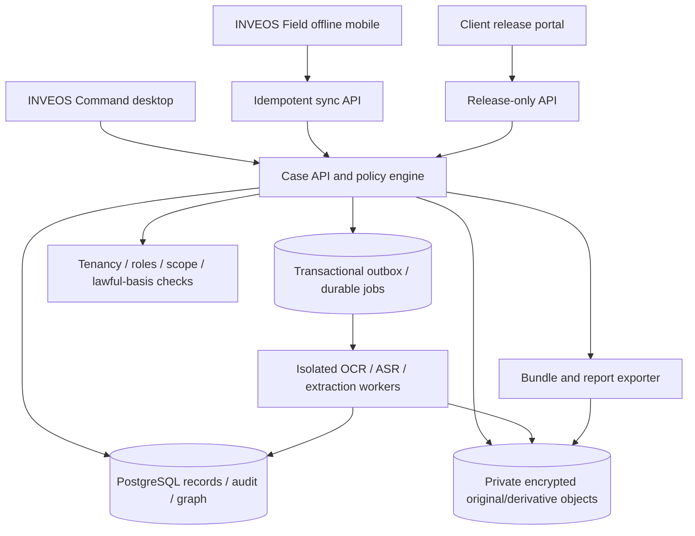

# 06 — Technical architecture

## Recommendation

**A modular monolith first**, with strict interfaces and event/outbox boundaries, is preferable to early microservices. Three user surfaces share one canonical case/evidence platform. Specialist extraction workers run in isolated processes; they never own the original evidence records. Treat the stack below as **proposed** until a working vertical slice proves it.

| Layer | Candidate choice | Rationale / decision gate |
|---|---|---|
| Command web | React + TypeScript + Vite or Next.js | Accessible data-heavy UX; design system, graph and evidence inspectors |
| Field mobile | Expo/React Native with encrypted SQLite; offline queue | iOS/Android device media controls and real persisted offline states |
| Client portal | Web app separate route/identity context | Release-only permissions and clear client isolation |
| API | TypeScript/Hono or Fastify modular HTTP service | API contracts, role gates, audit and validation |
| Database | PostgreSQL (Neon for prototype only if region/security suitable) | Tenant/case-centric records, transactions, relational graph and search |
| File/object storage | Encrypted S3-compatible private buckets; WORM-capable option for retention | Upload bytes and independent verification; policy and region review |
| Jobs | Durable queue/outbox plus isolated Python analysis services | OCR, transcription, preview, text extraction, report build and virus scans |
| Retrieval | Postgres FTS + pgvector candidate | Source-scoped search first, hybrid later, avoid early graph DB overhead |
| Identity | OIDC/SAML via approved identity provider, MFA | Tenant and client identity boundaries |
| Operational logging | OpenTelemetry-compatible tooling with strict data scrubbing | Debug workflows without logging sensitive case bodies |
| Reporting | Server-side PDF pipeline + editable template option | Repeatable report renderer and independent export manifest |

## Components



## Logical bounded modules

- `identity`: tenant, role, user, MFA/SSO, consent/authority records.
- `cases`: instructions, objectives, assignments, tasks, lifecycle, notes, costs.
- `sources`: public/commissioning-party supplied source acquisitions and reference metadata.
- `evidence`: binary intake, digests, derivatives, custody, access, hold, exports.
- `field`: capture sessions, offline revisions, queue receipts, dispatch.
- `analysis`: document extraction, ASR, proposed claims, review records.
- `entities`: identifiers, relationships and link evidence.
- `reports`: approved findings, sections, exhibits, sign-off, immutable release versions.
- `portal`: restricted clients, grants, downloads, revocation and messages.
- `administration`: policies, retention, audit inspection, plans/usage and deployments.

Shared domain events are stored transactionally and published by an outbox. An external queue must not become the only source of truth. Every consumer is idempotent; report/AI jobs can be cancelled, retried or superseded with explicit state.

## Isolation and data boundary rules

- All records include `tenant_id`, and all case records `case_id`. Tenant ID is obtained from authenticated context, never trusted from a client-supplied header.
- PostgreSQL RLS (where possible) complements application policy; test both. Use dedicated database credentials for workers with minimal privileges.
- Object paths must not constitute access rights. Use scoped short-lived URLs after server permission checks, with logs and revocation policy.
- Search results, graph neighbours, embedded chunks, job payloads and exports are filtered by the same policy; no cross-tenant embedding similarity leakage.
- Client release packages are immutable snapshots in a separate release namespace, not generic evidence file browsing.
- Private client content does not reach external AI service by default. Where chosen, require purpose, data-processing agreement, explicit routing and audit.

## Offline/mobile data pathway

```mermaid
sequenceDiagram
  participant F as Field device
  participant S as Sync API
  participant O as Object store
  participant D as Case database
  F->>F: Capture original + device UUID + time + local digest
  F->>F: Encrypt locally; queue persistent record
  F->>S: Reserve case-scoped upload, idempotency key
  S->>D: Validate role/scope; create pending receipt
  F->>O: Send bounded resumable chunks via scoped grant
  F->>S: Finalise original with expected digest
  S->>O: Server-side integrity verification
  S->>D: Atomically verify manifest and custody arrival event
  S-->>F: Durable accepted receipt + server timestamps
  F->>F: Mark verified; retain local data per device policy
```

A 200 OK on a chunk is **not** an accepted evidence receipt. Device time may be wrong; record timezone, time uncertainty, device time/monotonic offset where available, and server time independently. Do not infer whereabouts from device metadata unless necessary and authorised.

## Original vs derivative

Original bytes live in restricted store under content identity; OCR, transcript, preview, resized video, redactions, AI outputs and report renditions are *derived* objects linked by source digest, processing version, tool/model version and operator. A derivative may be discarded/recomputed without modifying the original. Media decoders run in restricted sandboxes with bounded file sizes, resource limits, timeouts and network denial.

## Deployment modes

1. **Pilot:** one UK/EU-region environment with strong encryption, backups and explicit no-real-data gate until privacy/security sign-off.
2. **Commercial cloud:** environment separation, tenant policy, HA, queued ingestion, disaster recovery and data processing agreements.
3. **Enterprise/self-host:** only after packaging, secrets handling, migrations, observability and support are proven.

## Architecture guardrails

- Do not adopt the entire NOIR stack by accident. NOIR handles security command/sensors; INVEOS handles legal investigations and case/evidence provenance.
- Do not require Neo4j in MVP. PostgreSQL relation tables + Cytoscape view suffice pending measured constraints.
- Do not assume object-storage encryption means immutable or evidentially secure storage. Administrative deletion, versioning, hold and tamper-evident anchoring need separate decisions.
- Every new external system needs connector privacy/terms, licences, accuracy, rate/expense limits and failure behaviour documented.
