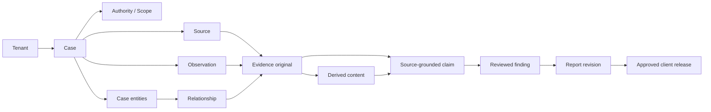

# 07 — Canonical data model and lifecycle

## Core entities

| Entity | Essential fields | Invariant |
|---|---|---|
| `Tenant` | id, region, status, policies | Strict isolation boundary |
| `User`, `Membership`, `RoleGrant` | identity ID, tenant, permissions, expiry | Case permissions also checked |
| `Client` | tenant, client reference, data agreement | Only client-authorised views |
| `Case` | id, tenant, title, scope, jurisdiction, status, classification | Purpose and authority established before collecting |
| `AuthorityRecord` | case, client mandate, lawful basis, LIA/DPIA refs, approver, expiry | Reviewable, versioned, no decoration-only approval |
| `Question`, `Task`, `Assignment` | case, owner, status, objective, due date | Assignment and acknowledgement separate |
| `FieldSession`, `Observation` | actor, case, device, original time/time zone, received time, correction parent | Immutable submitted versions |
| `SourceRecord` | case, origin URL/person/agency, method, access authority, retrieval time, terms | Source and credibility distinct |
| `EvidenceItem` | case, source, original object ID, SHA-256, byte length, classification | Original bytes never overwritten |
| `DerivedAsset` | evidence parent, kind, tool/model, parameters, digest | No derivative masquerades as original |
| `CustodyEvent` | item, event kind, actor, location, timestamp, prior digest | Append-only and tamper-evident |
| `Entity` | case, type, names/identifiers, confidence/review | Not a guaranteed identity |
| `Relation` | case, source, target, predicate, review status, supporting refs | No edge without provenance |
| `Claim` | case, statement, source spans, kind, extraction method, review status | Separate allegation/hypothesis/verified evidence |
| `Finding` | case, text, claims, reviewer, approval date | Human approval required |
| `ReportRevision` | case, template, author, citation map, PDF/DOCX digests | Draft vs approved separate |
| `Release` | case, client, immutable report revision, exhibits, approvals, expiry | Clients cannot browse case originals |
| `AuditEvent` | tenant, event, actor/service, prev hash, body hash, occurred/recorded times | Append-only, periodically anchored |
| `RetentionPolicy`, `LegalHold` | case/items, basis, schedule, approvers | Hold supersedes routine erasure pending review |

All primary keys are stable UUIDs/ULIDs with verified uniqueness. Only permitted cross-case sharing via explicit copies or client-approved link references; never implicit dedup of people across tenants.

## Relationships

## Distinguish data and editorial statuses

- `Evidence`: `pending`, `uploaded`, `server_verified`, `quarantined`, `held`, `release_eligible`, `retained`, `disposed` (physical/object lifecycle).
- `Claim`: `extracted`, `proposed`, `review_pending`, `accepted`, `rejected`, `superseded`. An accepted claim is **not** necessarily conclusive truth.
- `Report`: `draft`, `review_requested`, `approved`, `released`, `amended`.
- `Relation`: `candidate`, `confirmed_by_reviewer`, `rejected`, `withdrawn`.
- `Field item`: `local`, `queued`, `transferring`, `receipt_pending`, `verified`, `error`, `conflict`.
- `Case`: `intake`, `scope_review`, `active`, `review`, `closed`, `archived`. A client release is versioned independently.

## Database constraints

- Composite foreign keys `(tenant_id, case_id)` and unique scoped indices where practical.
- Append-only tables for custody and audit; no UPDATE/DELETE paths for ordinary roles; corrections create new rows.
- Unique idempotency keys scoped by tenant + device/user + operation; caller-visible response is stable across retries.
- Track source timestamp, acquisition timestamp, processing timestamp and event recording time separately.
- `source_span` data: page number and bounding text offsets, audio/video start/end milliseconds, exact quoted excerpt hash or OCR span ID.
- Explicit redaction and access tags are inherited by derived text, indexed search and exports.
- Keep queryable structures simple before considering an additional graph database. Use relation/evidence join indexes.

## Example claim and provenance chain

Invoice 0341 PDF (original hash) → OCR text block on page 2 (derivation job/version) → extracted invoice amount (candidate) → human reviewed claim (source-span citation) → approved comparison finding → report paragraph 3.2 → client release package v1. Corrections produce superseding entries, not rewritten past findings.
