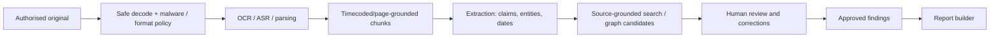

# 09 — AI analyst and evidence-grounded reasoning

## Principle

An AI model is a **research and drafting assistant**, not an investigator, judge or evidential authority. It must expose its supporting material and uncertainty; every published material claim is reviewed by an authorised person.

## Processing pipeline

## Functional components

- OCR and layout preservation for PDFs/scans; page-span anchors and confidence/quality flags.
- Audio transcription with original audio, speaker attribution uncertainty, timecoded segments and corrected text as separate derivation.
- Named entities (person/company/place/date/asset) with alias resolution proposals and evidence-backed review.
- Contradiction detection compares *source claims*, not assumed truths. Provide both passages and possible explanations (e.g., time zone, OCR error).
- Chronology suggestion stores precision (`exact`, `date`, `range`, `unknown`) and source clock uncertainty.
- Case Q&A uses retrieval restricted by tenant, case, classification and authorised content; responses show source span IDs, timecodes/pages and limitations.
- Report drafting consumes approved findings by default; any unapproved narrative is marked as a draft suggestion and cannot be silently published.

## Data protection and routing

- Prefer local or isolated inference for sensitive material; external providers only after DPA/privacy, residency, model-training/no-retention terms, task suitability and client instruction review.
- No data drawn from one client's case in answers to another client, even through indexes, embeddings, logs, cache or evaluation fixtures.
- Record model identifier, source hash, prompt/template version, parameters, time and reviewer decision. Never store unredacted client material in analytics tools.
- Document any model download weights/data licences separately from code repository licences.

## Evaluation and hard failure modes

- Grounding: a supported assertion must resolve to actual exact source span; missing span fails to unverified state.
- Citations must point to the right document and passage, not simply a related source.
- Evaluation corpus: synthetic and permissioned representative PDFs, OCR noise, mixed timezones, false positives, ambiguous identities, multi-speaker audio, malicious prompt injections inside uploaded files, privilege-scope leakage.
- Prompt injection from sources never changes tool authorisation, sends data outside policy, alters system prompts or performs side effects.
- Safety: no automated accusations, definitive criminality judgments, identity inference or protected-characteristic profiling; human review remains explicit.
- Drift: measure extraction precision/recall and reviewer edit rate by task and document quality, not only synthetic accuracy.

## Initial model/tool candidates (research, not dependency approval)

- `docling-project/docling` or Apache Tika for parsing; `tesseract-ocr/tesseract` and OCRmyPDF for scans.
- `ggml-org/whisper.cpp` for offline/mobile speech candidates; `SYSTRAN/faster-whisper` for server processing.
- Case-scoped full-text retrieval before introducing vector search; `pgvector`/Qdrant only if measured value.
- Evidence-backed graph visualisation via Cytoscape.js, not a model-produced graphic that asserts relationships by appearance.

## Definition of done

No release workflow can publish a model-only unsupported finding; reviewer can trace every published claim to source bytes and exact location; rejected suggestions are preserved in audit without recirculating as accepted facts.
