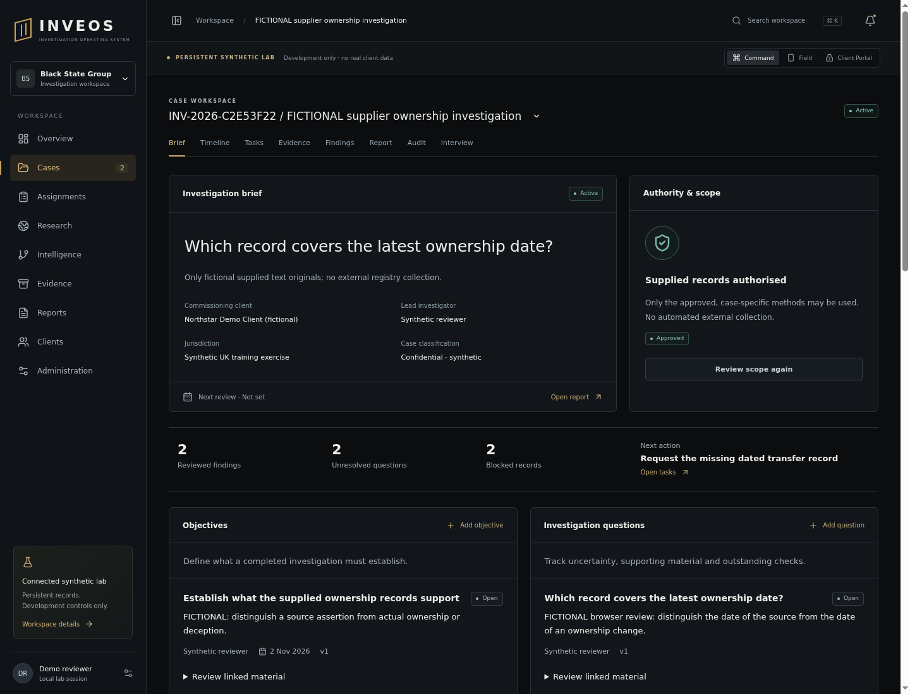

# Persistent investigation casework — verification receipt

27 October 2026. This change builds on `4e4664e` (the scope/CI draft). The final
review commit and hosted run are recorded in its draft PR. All records are
visibly fictional. No production database or service was changed.

## Implemented slice

- Persistent objectives, questions, hypotheses, tasks, notes and handovers;
  ownership from case membership, deadlines and case progress from saved data.
- Optimistic edits with reasons and immutable revision snapshots; retries do not
  create duplicate work records. A revoked assignment denies further access while
  preserving historical ownership. Only the recipient acknowledges a handover.
- Supporting/contrary/context links to exact-source claims, original-byte checks
  at attachment and source-reverified supported/disputed hypothesis assessments.
  No hypothesis creates a reviewed finding.
- Casework search, saved-session/case/view restoration and correct source-time
  ordering across UTC offsets. Internal API responses are marked `no-store`.
- A full branded draft print view with reviewed passages, unresolved questions,
  limits and exhibits. JSON export carries a separate working-context section and
  fingerprint. Internal notes and handovers are excluded from that report model.
- An offline JSON verifier for original digests, UTF-8 ranges, policy context and
  an optional independently trusted full-file fingerprint.
- Ordered, transactional, checksummed migrations with an advisory lock; existing
  pre-ledger foundation databases upgrade without recreating their case records.

## Database, HTTP and source checks

Local runtime: Debian 12 ARM64, Node 24.22.1, npm 11.19.1, Python 3.11.2,
PostgreSQL 15.19. The application role has no superuser/create-database/create-role
or RLS-bypass privilege. This is application policy enforcement, not a claim that
database RLS has been implemented.

| Check | Evidence |
|---|---|
| Real PostgreSQL/Fastify API suite | 19 passed, 0 failed: existing workflow plus persisted work/restart, concurrent edits, immutable history, retries, owner/parent scope, calendar/Unicode validation, source mutation, cross-case/tenant/client/revoked access, handover permissions and legacy migration upgrades/checksums |
| Python source validator and unit tests | 18 passed: 13 foundation tests plus 5 verifier tests, including changed originals/spans, invalid policies/times, duplicate keys/identities, release-status rejection and trusted-fingerprint replacement detection |
| Live TCP HTTP evaluation | [32/32 checks](casework-http-results.json), including 30 actual loopback requests and 2 offline verification checks; no HTTP mocks |
| Live HTTP timing | 198.78 ms total over the recorded 30 requests; 0.90–25.22 ms per request on this local synthetic corpus. These are not production latency or capacity results |
| Static/build checks | Lint, all workspace type checks, web build and whitespace checks; hosted CI results belong to the PR's exact review revision |

The live evaluation creates a case/authority, all six work kinds, two distinct
originals with different source dates, quoted claims, supporting/contrary links,
two reviewed source assertions, a blocked follow-up, a corrected note and an
acknowledged handover. It checks rejected calendar/title/owner/tenant inputs,
unsupported hypothesis promotion and stale edits; then exports/verifies the draft
and rejects a changed original. The original assertion and the ownership truth
remain distinct. Inputs come from the agreed fictional supplier scenario, not
observed pilot-user frequencies or a customer dataset.

Reproduce against the running local lab:

```bash
python3 tools/verify_casework.py
python3 tools/verify_report.py .local-data/casework-verification/draft.json
python3 tools/verify_report.py .local-data/casework-verification/draft.json --expected-sha256 TRUSTED_FINGERPRINT
```

The third command requires the actual fingerprint received independently.
Artifacts go to ignored local storage. The verifier opens no referenced paths and
does not call INVEOS or an external service. A hash travelling beside a replaced
file does not authenticate that file. Replacing the whole report without a trusted
fingerprint is explicitly outside the verifier's authenticity guarantee.

## Browser and print evidence

Actual Chromium 156 over the running HTTP API and PostgreSQL:

1. Entered the synthetic lab and opened its saved supplier case.
2. Created a question, child hypothesis, owned task and multilingual working note.
3. Revised the task to blocked with a reason; linked contrary source material and
   opened the exact cited evidence. Source inspection used the linked evidence ID.
4. Reloaded and restored the lab, case and page; saved records remained present.
   Inspected both versions of the corrected note and searched/opened a saved task.
5. Exported actual JSON and inspected its SHA-256 field. The independent verifier
   passed the report and rejected source mutation in the live evaluation.
6. The print action rechecked the report and opened Chromium's print preview.
   A complete two-page A4 draft was generated through Chromium's PDF rendering
   interface. Both pages were rendered with Poppler and inspected for content,
   layout and source metadata. A print CSS load-order/background defect was fixed.
7. Inspected desktop 1440×1100 and mobile web 390×844 renders; horizontal document
   overflow was false at both widths. These are browser viewports, not native
   iOS/Android or a comprehensive accessibility assessment.



[Mobile web render](assets/casework-mobile.png).

The report PDF is a browser print draft, not a canonical server-generated report
or signed release package. The JSON verifier does not verify that PDF's content.
PDF parsing/OCR, real identity/MFA, encrypted production storage, native encrypted
offline capture, client release, penetration, outage and restore verification
remain unimplemented or unrun. No pilot acceptance is claimed.

## Privacy, licence and rollback

Only supplied fictional text fixtures and generated synthetic accounts/cases were
used. No collector, external AI service, client message or deployment was enabled;
no npm/Python application dependency was added. The existing rights-reserved
position remains. Work items inherit the case access boundary; case notes and
handovers remain internal. Unknown JSON fields now fail validation rather than
being silently discarded.

Apply migrations using the documented development administrator. After migration,
rollback the application source to the earlier version if necessary; new tables
can remain intact. Do not delete revision history or rewrite an applied migration
file as a rollback. Use a separately reviewed forward migration for subsequent
schema changes. Database administrator tampering remains outside append-only SQL
guarantees.
