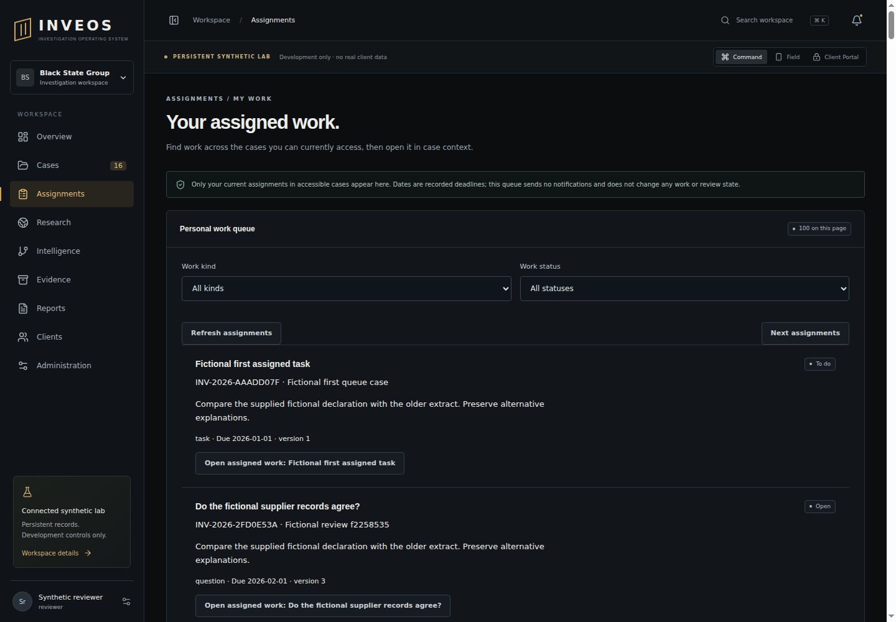

# Personal assigned-work acceptance — 29 October 2026

PR #83 final implementation `b91b90623a14a34ef633e41116fec595e62265a5` passed [Checks 40944589175](https://github.com/BlackStateGroup/inveos/actions/runs/40944589175): **287 Node/116 Python tests, zero failures/skips**, lint, types, build, actual restricted PostgreSQL/API, 23 sandboxed browser journeys and worker isolation probes. The initial API-only head `a2632aa` passed Checks 40940481310 but did not implement pagination or an Assignments interface. Review identified and completed those omissions before merge.

Three focused PostgreSQL tests cover owner/current-case filtering, client denial, reassignment and deadline corrections, same-user multi-tenant separation, current-role downgrade, membership revocation, malformed cursors and exact traversal of 201 dated/undated rows. Excerpts are bounded to 260 characters and bodies are excluded. The SQL capacity fixture exercises the query contract, not representative production investigation history.

Checks 40943929714 at `ea1a1b84` failed the browser status-filter fixture: records were titled tasks but used the default question kind, so Complete was correctly rejected. The final fixture creates task records and asserts the save response. No application status or rate-limit control was weakened. The final actual browser journey pages forwards/backwards, filters Complete, opens the correct case/work record, reloads, checks 390px overflow and clears revoked-case work. The retained 1440px screenshot was inspected: the filters, page controls, case references, deadline and work actions are legible without overlap.

## Source and privacy review

Reviewed the current session/internal-role guard, explicit tenant/owner/membership joins on every page, parameterised filters/cursors, two-second query bound, additive tenant/owner/deadline index and response minimisation. A forged cursor cannot expand visibility. The interface clears old results before fetching, aborts superseded reads, clears failed navigation results and refreshes authorised workspace membership before opening a row. Filters are temporary. No new dependency, copied research source, outbound notification, tracking or live data is introduced.

The list is mutable: concurrent ownership/deadline/status changes can move rows between pages. Refresh starts again; no frozen pagination claim is made. The existing workspace loader used when opening a case remains a separate large-case performance concern. Native device acceptance, contractor-specific policy, workload/preferences and meaningful event notifications remain open. This scoped source/privacy review is not independent security or professional acceptance.

[Contract and reproduction](../89_ASSIGNED_WORK_QUEUE.md).

Final merged head **`b229c18d11db632cfa753d942e01e8e0c0148b8f`** passed [Checks 40945812670](https://github.com/BlackStateGroup/inveos/actions/runs/40945812670): **287 Node/116 Python, zero failures/skips**. Evidence-head Checks 40945286401 exposed an early click on the disabled Previous button while loading. The final test waits for enabled navigation and actual results; the application/render is unchanged from the inspected run. PR #83 merged as `4eca42dcae5c62c3fc60656347e95fc5822972ba`.
