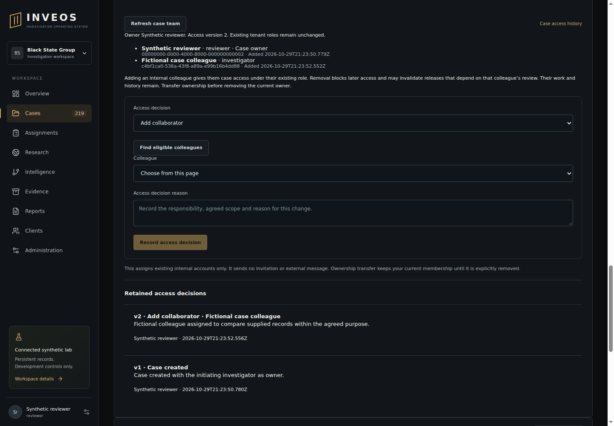

# Case access acceptance — 29 October 2026

Application code `46b72319ad39537b861f78268d0fa13f9a4d6a6e` passed [Checks 40956965156](https://github.com/BlackStateGroup/inveos/actions/runs/40956965156), job 123739437708: **311 Node and 120 Python tests, zero failures/skips**, including all 26 sandboxed browser journeys, restricted PostgreSQL/API, worker-host isolation probes, lint/types/build/foundation. The retained 1440px render was inspected: current collaborators, owner, decision form and attributed history are readable. The browser's 390px overflow check passed.

Seven focused PostgreSQL tests exercise owner-only existing-account assignment, stable retries/version races/restart, removal and ownership transfer without role escalation, current tenant/case/role/CSRF denial over loopback HTTP, atomic audit rollback for grant/removal/transfer, preserved work/authorship, search/queue/mention/original/report denial and actual worker-lease cancellation. Tests traverse 51 candidates, 52 current members and 52 immutable events. A real upgrade from the pre-041 schema preserves old owner/membership dates and records an explicitly current migration checkpoint with no attributed historical decision.

The lock-wait regression first reproduced a write returning 200 and persisting after an administrator removed membership while the case lock was blocked. The shared locked-case lookup now rechecks membership and the request role in a fresh SQL statement after obtaining the lock. The same regression returns 404 and records no work. Existing worker operations acquire the case lock before their separate permission query. This is not an instant recall of already downloaded data or reads authorised before revocation.

The browser registers a collaborator through the actual form, loses a committed response, retries without duplicating history, reloads and reads the retained decision, transfers ownership, loses management controls and clears the revoked case after the new owner removes the former owner. Candidate pages are traversed through their controls; no first-page assumption is made.

At backend implementation `fcf7cb9848cd623b5b76845536027cf20d00afc4`, [Research 40956083916](https://github.com/BlackStateGroup/inveos/actions/runs/40956083916), job 123736446784, passed the actual encrypted supplier/native/OCR/browser/original-page comparison, independent package/PDF verification, restricted recipient delivery/acknowledgement/revocation, repeated isolated raster and five PostgreSQL/actual daemon-failure worker checks. The later commit changes only candidate-page UI/readiness and the handoff; backend/parser/worker code is unchanged. The [machine receipt](case-access-supplier-receipt.json) is extracted from actual TAP output, not a synthetic adapter. It explicitly records `realProfessionalReview:false`.

Failure history: main after #85 failed Checks 40955309441 when the existing discussion browser test dereferenced `document.body` before navigation created it; the null-safe readiness predicate now passes in both branch runs. Initial access Checks 40956091298 passed 310/311 Node tests but failed candidate-page readiness because `.disabled` does not include disablement inherited from a fieldset. The final test waits for the loaded page and `:disabled`; the interface also reports loaded/empty pages. Locally, a first-page fixture assumption, an unavailable UPDATE privilege required by `FOR SHARE OF memberships`, and a UUID/text upgrade-fixture parameter ambiguity were corrected. No role-update privilege was granted.

Source/privacy review found no new dependency, copied runtime, external invitation/message, live data or production action. Case owners manage only existing tenant identities under their current roles; clients cannot use the internal interface. Access events remain immutable and do not alter evidence, findings, authority or release decisions. [Policy, limits, reproduction and unmet provider/contractor/admin gates](../92_CASE_ACCESS.md).

