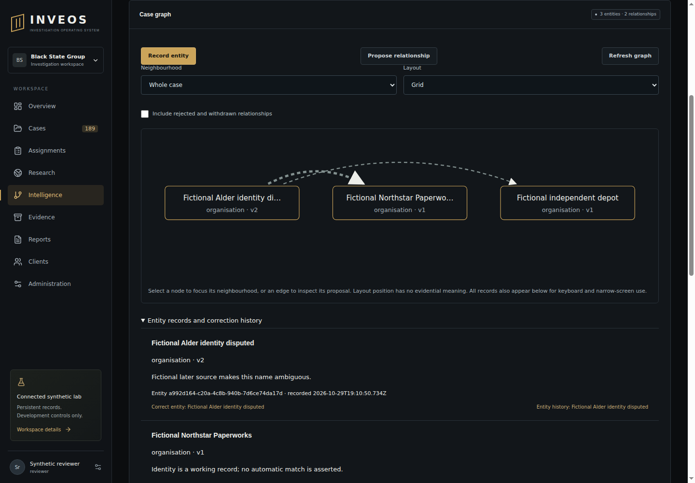

# Case graph acceptance — 29 October 2026

Scope: manual case-scoped entity identities, explicit relationship interpretations, exact reviewed text/document references, independent reviewer decisions and retained corrections. No automatic identity merge, live collection, copied research runtime or new dependency. This is a bounded investigation journey, not full platform or production acceptance.

## Actual local API and PostgreSQL evidence

Five focused graph tests passed through the real Fastify handlers/middleware and restricted-role PostgreSQL, using first-party fictional fixtures. These local API requests use the application's injection transport; actual browser/HTTP execution is recorded separately below. The combined suite passed 258 Node tests with 21 browser checks skipped (279 total), plus 116 Python tests, lint, type checks, build and foundation validation. Local Chrome isolation is unavailable and was not weakened.

The executed cases include:

| Behaviour | Observed result |
|---|---|
| Distinct entities with the same label | Different immutable identities retained |
| Proposal with exact current entity versions | Candidate saved with typed source fingerprint |
| Self edge, foreign-case endpoint, duplicate sources | 422 denial |
| Foreign-case source finding | 404 denial |
| Wrong review digest | 409 denial |
| Reviewer who authored the relationship | 403 denial, including after role change |
| Independent acceptance and exact replay | One immutable accepted decision |
| Changed replay reason | 409 denial |
| Entity correction after acceptance | Old pinned label retained; current edge needs review |
| New proposal using stale endpoint version | 409 denial |
| Proposal revision | New candidate, prior decision remains historical |
| Changed original bytes | Source inspection and acceptance denied |
| Rejection with unavailable original | Explicit negative decision retained |
| Withdrawal and replay of original create request | Latest withdrawn revision returned |
| Database history mutation / restricted root-field update | Append-only/permission denial |
| Server restart and metadata search | Stored withdrawn interpretation retained |
| Unrelated tenant, case member and client | 404/403 denial; no graph/history/source disclosure |
| Missing CSRF | 403 denial |
| Changed authority | Fresh acceptance and source inspection denied |
| Revoked case assignment | Read and mutation denied |
| Audit insertion failure | Proposal/decision transaction rolled back |
| Racing decisions / entity corrections | One success and one conflict |
| Document-backed source | Exact original, page, quote and finding identity retained |
| Altered stored source fingerprint or proposal actor binding | Listing/history denied |
| Superseded document correspondence | Source inspection denied; listing remains explicitly historical |
| Invalid/control/oversized text, empty/overfull sources, zero endpoint version | Validation denial |
| 200 entity identities | Bounded listing; 201st create denied |

Source/privacy review checked same-case foreign keys, current membership/CSRF, immutable grants/triggers, independent decision ownership across **all** proposal versions, source hashing and revalidation, generic audit summaries, React text rendering, bounded SQL and access-denial clearing. The review added explicit proposal actor/time/identity binding checks; a timestamp-column alias collision caught by the focused suite was corrected. Document fixture assertions use the stored citation object. These are scoped engineering checks, not independent professional, security, privacy or legal sign-off.

## Browser and exact revision receipt

Implementation `518ecc56383fc89a4d313b97795007e41cf7df41` passed [Checks 40936434954](https://github.com/BlackStateGroup/inveos/actions/runs/40936434954), job 123668089297: **279 Node/116 Python, zero failures/skips**, including all 21 actual sandboxed browser journeys and worker isolation probes. The graph browser journey passed create/propose/source-inspect/independent-review/reload/correction/history/revocation and 390px overflow checks. Visual inspection of the retained 1440px render found hidden arrowheads and a long edge behind an intervening node. The follow-up routes arrows to box boundaries with curved separation. Final code **`ca2c708a6a3f5c95cc6002db719dbf7a2e8170f7`** passed [Checks 40937297637](https://github.com/BlackStateGroup/inveos/actions/runs/40937297637): **279 Node/116 Python, zero failures/skips**. All 21 browser journeys and worker isolation probes passed again. The final 1440px render (artifact 12924279176) was inspected: direction is visible outside the entity boxes, long edges clear the intervening node, and full historical labels remain available in the record list. This is a tiny fictional graph and does not prove representative large-case layout/performance.

First-party derivative fixtures prove application joins and stale correspondence denial; they are not actual native/OCR parser benchmarks. Existing supplier runtime/isolation receipts remain separate. [Contract and reproduction](../87_CASE_GRAPH.md); [remaining plan](../71_REMAINING_DELIVERY_PLAN.md).
