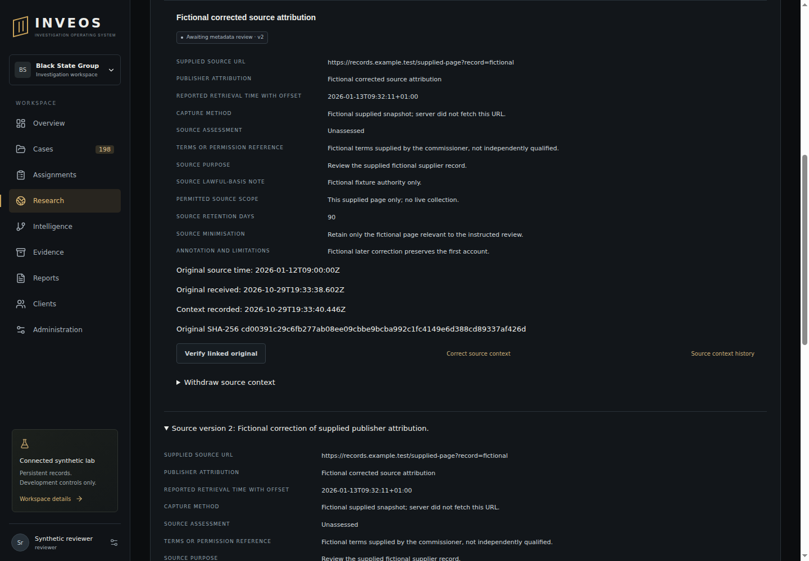

# Manual supplied-source acceptance — 29 October 2026

Scope: source context and policy notes attached to preserved fictional originals, with independent **metadata** review and immutable corrections. The service never fetches the supplied URL. Metadata review is not source-use authorisation, legal approval, source truth, quarantine clearance or client release. No new dependency or copied research source.

## Executed local checks

Implementation on PR #82 passes 261 Node tests against real restricted-role PostgreSQL, with 22 browser tests skipped (283 total), plus 116 Python tests, lint, types, build and foundation validation. Three new focused tests exercise source lifecycle, HTTP validation/access and integrity/concurrency/rollback.

The actual loopback HTTP matrix executes **33 assertions**: 18 malformed/unsafe URL/date/metadata/retention cases rejected with 422; a foreign-case original rejected with 404; four read routes plus withdrawal denied for both a client and an unassigned internal actor; authorised register/original reads succeed; revoked assignment denies both reading and correction. URLs use fictional `example.test` data and are passed as metadata only. This is real HTTP to the local application, not a mocked fetch adapter or live source collection.

Additional real API-handler/PostgreSQL cases preserve original source time, original receipt time, exact reported retrieval offset and server registration time separately. They verify role-upgraded author self-review denial, independent review/replay, correction starting a new pending revision, retained earlier decision/attribution, withdrawal/create replay, immutable database grants/history, application restart and searchable withdrawn context. Changed original bytes deny inspection, acceptance and correction. Audit failures roll back both new records and decisions; conflicting edits produce one success/one conflict; changed authority blocks acceptance while permitting historical withdrawal.

The first focused run found an assertion reading a non-existent `Evidence.sha256` property; the actual contract uses `Evidence.digest`. The assertion now compares the inspected digest with that original upload receipt. The corrected focused and combined suites pass. No application control was weakened.

## Source and privacy review

Reviewed current tenant/case/session/client checks, CSRF/origin controls, same-case original foreign key, fixed evidence identity, canonical revision digest and actor/time bindings, independent reviewer ownership across every revision, current-authority/source-retention checks and immutable review uniqueness. All URL/policy values are bounded, stored as supplied and rendered through React text. Original verification uses the existing encrypted/plain original adapter. Stored metadata listing is explicitly not a fresh verification. Audit summaries omit URL/policy/annotation content; no external notifications or requests occur. Access denial clears fetched records, history, original receipt and editors. Additive migration 037 preserves existing data; code rollback does not require dropping history.

This is scoped engineering review, not independent privacy/legal/security sign-off. Legal sufficiency cannot be decided by a metadata form or tests. Enforceable collector policy/terms registry, approved external connectors, source-context export integration, preservation/destruction policy and representative large-case performance remain open.

## Hosted browser and rendering

PR #82 code `d412976b73ceca8e0dc3d8901b1aa6254779e877`, Checks 40939264854, failed because later source fixtures inherited the shared application instance's 120-request/minute bucket after earlier tests. The first source read was rate-limited and subsequent fixtures could not create cases; the source browser journey did not start. New source fixtures now create fresh application instances using the real unchanged rate-limit policy. A clearer status assertion retains the actual response if listing fails. The fixture-isolation follow-up **`d3e4928dafdf988dcd9c64015e7fc312d4741640`** passed [Checks 40940030262](https://github.com/BlackStateGroup/inveos/actions/runs/40940030262): **283 Node/116 Python, zero failures/skips**, including all 22 actual sandboxed browser journeys and worker isolation probes. Source save/lost-response retry/review/correction/reload/history/revocation and 390px overflow passed. Inspection of the actual desktop render found inherited definition-label margins offsetting labels from values; final code **`5d26c184ee9cea54816e5c9a961507812fb0b02c`** corrects alignment and assessment labels and passes [Checks 40940748766](https://github.com/BlackStateGroup/inveos/actions/runs/40940748766), job 123683170747: **283 Node/116 Python, zero failures/skips**, all 22 actual browser journeys and worker isolation probes. The 1440px final render (artifact 12928115291) was inspected: labels align with values, all four timestamps remain distinct and correction history is readable. The browser also asserts label/value alignment and 390px overflow. [Contract/reproduction](../88_MANUAL_SOURCE_REGISTER.md); [canonical remaining plan](../71_REMAINING_DELIVERY_PLAN.md).

