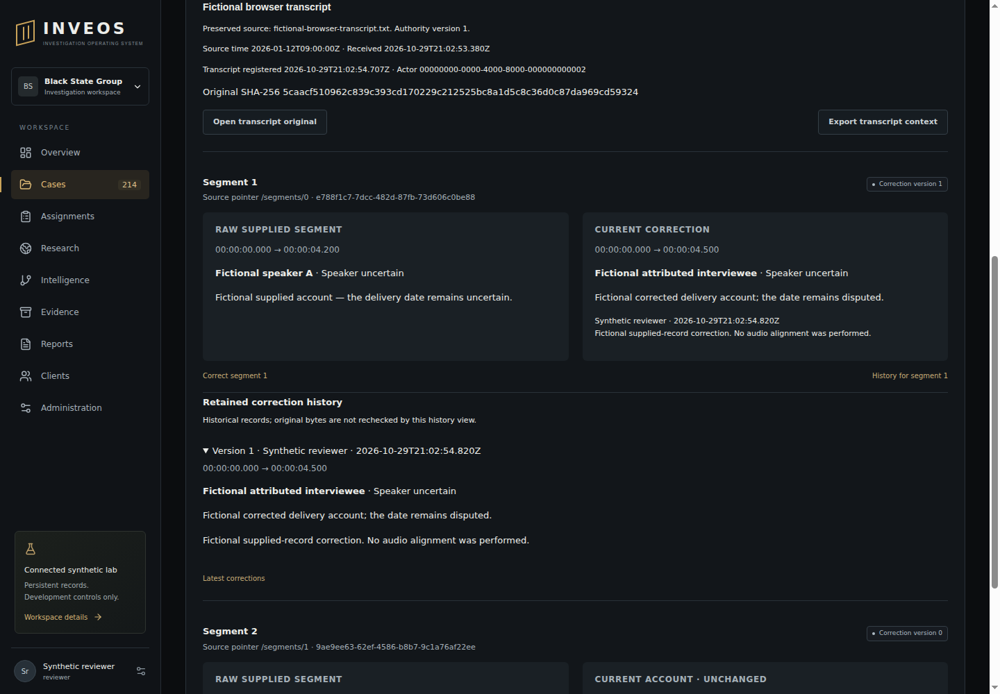

# Supplied transcript acceptance — 29 October 2026

Final application code `140abcfcc260365fde07a0a296a8d2b5f1a63828` passed [Checks 40953908599](https://github.com/BlackStateGroup/inveos/actions/runs/40953908599): **303 Node and 120 Python tests, zero failures/skips**, all 25 actual sandboxed browser journeys, restricted-role PostgreSQL/API, lint/types/build/foundation and the worker-host isolation probes. This is supplied-record engineering acceptance, not audio/parser benchmarking or product completion.

Nine focused PostgreSQL transcript tests also passed locally. They exercise exact preserved BOM/Unicode bytes and overlapping supplied segments; corruption and unsupported/duplicate raw content rejection; stable correction replay, concurrent version conflict and restart; immutable raw/history and guarded heads; both registration and correction audit rollback; actual loopback HTTP role/tenant/case/CSRF/revocation; authority supersession/closure; 51-record list traversal and 28-correction history paging. An actual API export is checked by a copy of the standalone verifier outside the repository. Python checks include rehashed fabricated raw/current/history, promoted status, duplicate keys, oversized input, boolean-number substitution and supplied integer-valued JSON notation.

The new browser journey registers the supplied fictional original, edits a declared range/speaker/text with reason, discards an actual committed response and retries without duplicating history, reloads, inspects the retained correction, downloads a package verified by Python, navigates to the original and clears loaded context/editor after membership revocation. Its 390px overflow check passed. The retained 1440px render was visually inspected: raw and corrected accounts, declared ranges, uncertainty, source fingerprint and attributed history are legible.

Review found and fixed the contributor migration's invalid DELETE trigger, unverified original bytes, unrelated raw transcript text and duplicate-key discrepancy between API/offline checks. Initial contributor Checks 40948117555 failed lint. Implementation `2e8834a` passed Checks 40953186311 (303/120, zero skips), but its render exposed an incorrect light background behind light text. The final theme-token fix passed the later run above; the earlier render is not visual acceptance evidence.

Source/privacy review: no new runtime dependency, model, copied research source or external collection. Current server case/tenant/role checks and authority pinning apply; client access is denied. Audit summaries do not copy transcript text. Raw original bytes and every correction remain separate. The verifier's self-contained fingerprints do not authenticate actors/publishers, prove truth/audio alignment or authorise disclosure. [Contract, reproducible commands and remaining WP11 criteria](../91_SUPPLIED_TRANSCRIPTS.md).

