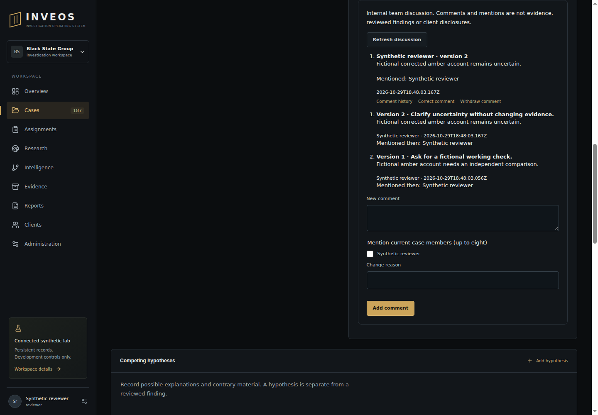

# Internal discussion acceptance — 29 October 2026

Scope: fictional case work comments, immutable author corrections/withdrawal, current-member mentions and private per-version read acknowledgement. This is an integrated development journey, not full platform, contractor policy, native-device, provider/MFA or production acceptance.

## Source and privacy review

The reviewed feature uses current session/tenant/case/internal-role checks and existing CSRF/origin controls. Each route scopes comment/work identities to the selected case. Mention targets are checked against current internal case assignments. Only the author can correct/withdraw; restricted SQL grants preserve original author/identity/work anchors. Revision/read tables are append-only. Case locking and audit transactions prevent partial updates; duplicate read receipts are harmless. Plain text renders through React text nodes. Audit summaries omit bodies and mention names. The feature sends no email/push/external message and neither edits evidence nor publishes findings/releases. No new dependency or copied catalogue source is incorporated.

Initial code `7a977aa59cef0b586a3911c0097d3e3435e5d1d5` passed Checks 40931265948: 271 Node/116 Python tests, zero failures/skips. Actual restricted PostgreSQL, sandboxed browser and worker-host qualification ran. New database cases covered author/tenant/case/client denial, revocation, restart, edit races, withdrawal/retry, immutable history, current-version reads and audit rollback. The initial desktop capture showed the brief/inbox, not the lower comment panel.

## Follow-up findings and verification

The browser at `4564f0ad1a8ace62cd5a8392d7e14a5c839a7fb5` passed notification entry, persisted read acknowledgement and clearing loaded discussion/history after case revocation. Checks 40932716735 failed one newly added assertion: the existing application returns 422 for schema validation, while the test expected 400. The invalid request was rejected; the assertion was corrected without weakening the API. Superseded/cancelled runs are not acceptance receipts.

Inspection of the retained lower-panel screenshot found that a shared full-width input rule stretched mention checkboxes and squeezed the recipient name. Targeted checkbox sizing and wrapped action spacing correct that defect; a browser dimension check guards the regression. The concurrent review's downgraded-investigator-to-client denial test is retained.

Final combined implementation **`a3ff3ce8893fb7499ff296750727341c48dace9b`**, [Checks 40933739089](https://github.com/BlackStateGroup/inveos/actions/runs/40933739089), job `123658861740`, passed **273 Node/116 Python tests, zero failures/skips**, lint/typecheck/build/foundation and actual worker-host qualification. All browser journeys ran on sandboxed Chrome, including the discussion create/correct/reload/history/read journey, notification entry, current case-revocation denial and clearing loaded comment/history. The current-role downgrade regression also passed. Narrow-screen overflow and checkbox/name dimensions passed. The application has not changed in the final evidence update.

The retained final lower-panel image was inspected at 1440×1000: member name and checkbox align normally, controls have usable separation, and both original and corrected comments remain readable. This is visual inspection of the fictional application UI, not source-document pixel fidelity. Artifact `12923328091` from that exact run had ZIP SHA-256 `2eedc203491bdc2d34fcc98c2d0e551fcbdb5333ff0596c53ba3d81093514a6c`.

Reproduction and limits: [discussion contract](../86_WORK_DISCUSSIONS.md). Remaining wider work is tracked in the [canonical plan](../71_REMAINING_DELIVERY_PLAN.md), with exact continuation state in BUILD_HANDOFF.md. A comment or mention read is not an evidence review, finding, agreement, handover acknowledgement or client approval.
